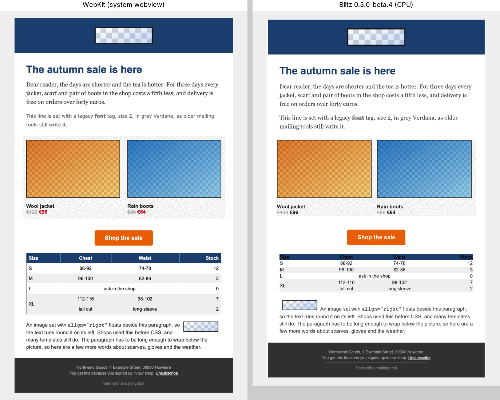
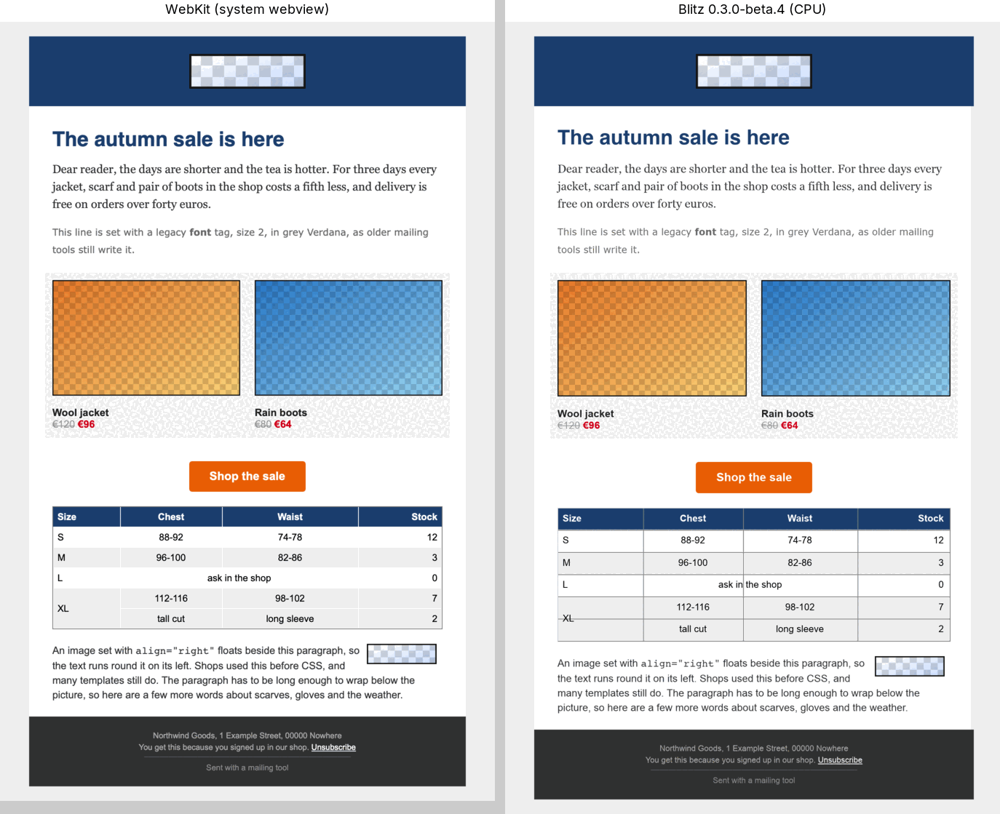
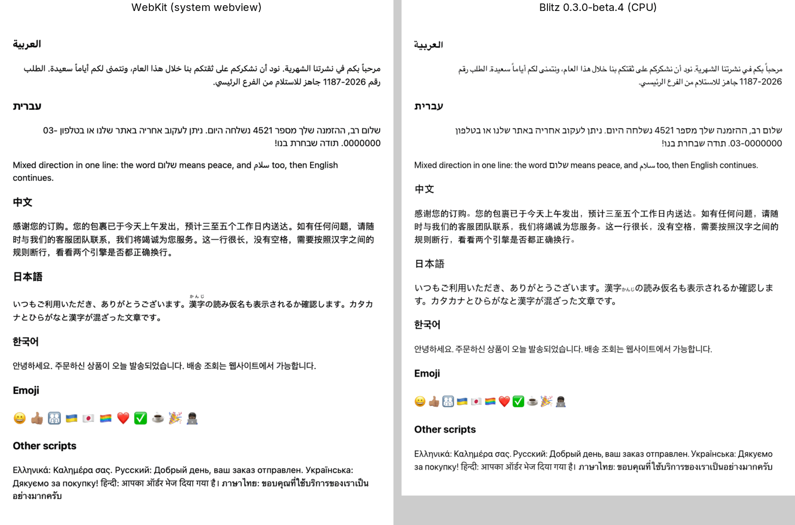
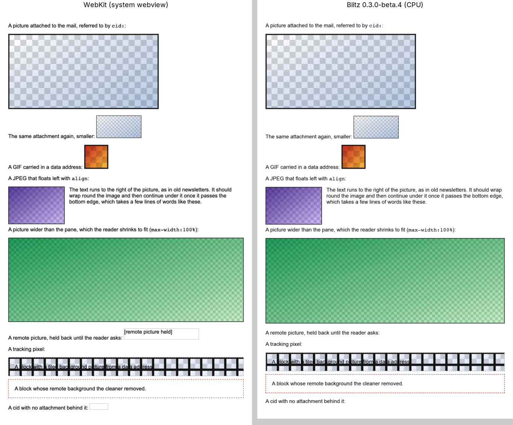
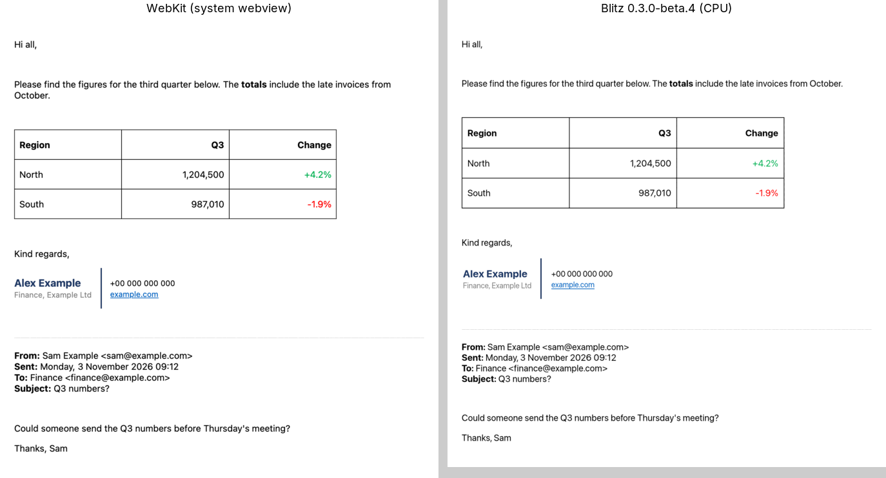
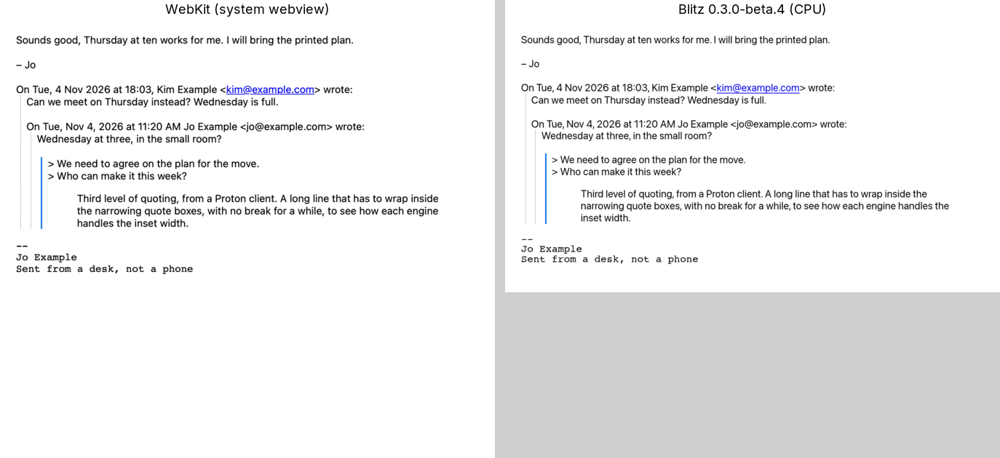

# Blitz for the mail reader

Whether [Blitz](https://github.com/DioxusLabs/blitz), an HTML and CSS engine in Rust with no JavaScript, can draw the
body of an HTML mail in place of the system's webview. Measured on 2026-11-21 outside the app; nothing of it is built
into the app yet. The client is unofficial and not affiliated with Proton AG.

**In short.** For the mail the app shows, Blitz is fast enough and lighter than WebKit, reaches nothing on the network
by itself, and runs no script. Between it and the default stand: legacy newsletter markup it does not understand
(closable in `core/src/html`, shown below); hostile mail that overflows its stack or memory inside the app's own
process, where WebKit had a process of its own (limits that stop it are given below); a build step that needs Python;
and screen readers, which would lose the mail. The recommendation is at the end.

## What was measured

Made-up mails, written like real ones: a newsletter of nested tables with `bgcolor`, `width`, `align`, `cellpadding`,
`
` and ``; an Outlook mail with `MsoNormal` paragraphs and a bordered table; Gmail and Proton quoting
three levels deep; Arabic, Hebrew, Chinese, Japanese with ruby, Korean, emoji, Greek, Cyrillic, Devanagari and Thai;
pictures by `cid:` (put in as data the way `inline_images` does), by data address, floated, wider than the pane, held
back, and as a CSS background; and long letters (255 KB, and 2.5 MB with 58,000 tags, the most the cleaner passes).
Each went through `html::protect` and into the reader's own page (`mail_view::document`).

- **Blitz:** blitz-dom, blitz-html, blitz-paint 0.3.0-beta.4 (crates.io, 2026-10-16) with default features off and only
  `system-fonts` and `floats`; anyrender 0.14 and its CPU backend `anyrender_vello_cpu` 0.18. No `blitz-net`, no
  `blitz-shell`, no GPU, no SVG, no accessibility. The app's fit (a page wider than the pane drawn smaller, down to
  half) is done in Rust by laying out wider.
- **WebKit:** the same pages in one warm `WKWebView` out of sight, with the app's own fit script, drawn through
  `createPDF` at 2x as `mail_picture` does.

The machine was shared with other builds while this ran, so times are rough; memory is the steadier figure.

Note on versions: crates.io's newest Blitz is 0.3.0-beta.4; the 0.2 line is from 2025. The anyrender 0.15 releases of
2026-11-16 (`anyrender_vello_cpu` 0.19, `anyrender_skia` 0.13) do not fit the published blitz-paint, which wants 0.14.

## Pictures

WebKit on the left, Blitz on the right, 680 CSS px wide at 2x.

As Blitz 0.3.0-beta.4 draws it: `` is ignored (the grey Verdana line comes out black serif, the
prices black, and the white table header dark on navy), table `border` and `cellpadding` are ignored, and the picture
with `align="right"` does not float. Blitz's own list of legacy attributes
(`synthesize_presentational_hints_for_legacy_attributes` in `stylo.rs`) covers `align` as text alignment, `width` and
`height`, `hspace` and `vspace`, `border` on pictures, the body's margins, `bgcolor` in hex only, and `hidden`.

The same mail after a pass in Rust that writes those attributes as CSS rules of no specificity (`:where(...)`) ahead of
the mail's own, which is where browsers rank them: ``, table `border`, `cellpadding`, `cellspacing`, `align`
floats, `valign`, named colours and `
`. What remains is Blitz's own table layout: columns are shared out more
evenly than WebKit's, and a collapsed border is drawn through a cell that spans rows or columns ("XL", "ask in the
shop"). Blitz lists full table layout for 1.0.

Arabic and Hebrew are shaped, ordered and set right, CJK and the rest are right. Ruby is drawn inline (Blitz's
backlog). Emoji were blank at first; the cause was confirmed: `anyrender_vello_cpu` builds `vello_cpu` without its
`png` feature, so the glyph renderer skips Apple Color Emoji, whose glyphs are PNGs. Asking for `vello_cpu` with `png`
brings them back, as here.

Pictures by `cid:` and data address, a CSS background from a data address and the shrinking of a wide picture match
(with the legacy pass, `align="left"` floats too). A held or missing picture leaves no frame or alt text in Blitz.

 

Outlook's table and signature and three levels of quoting match. Blitz's sans-serif is a little narrower, so lines
break a few words later.

## Time and memory

The reader's pane at 680 CSS px, 2x. WebKit: from loading the page to the fit script's answer, which is when the app
shows it; painting follows on the GPU. Blitz: from the HTML to the first screen's pixels, with one font context kept
for every mail as the app would keep it.

| mail | WebKit | Blitz | Blitz memory for the mail |
|---|---|---|---|
| newsletter | 233 ms | 22 ms | +11 MB |
| Outlook | 29 ms | 28 ms | +8 MB |
| replies | 24 ms | 7 ms | +7 MB |
| scripts | 209 ms | 118 ms | +9 MB |
| pictures (352 KB) | 24 ms | 20 ms | +15 MB |
| long (255 KB) | 50 ms | 123 ms | +25 MB |
| longest the cleaner passes (2.5 MB) | 336 ms | 849 ms | +149 MB |

- Without a kept font context every mail finds the system's fonts again: 40 to 80 ms more each. The first time in a
  run takes 0.1 to 0.6 s.
- Painting a screen of 1360x1200 pixels further down a long letter takes 28 to 42 ms at the median and up to 87 ms
  (`page::tests::scrolling_cost`): too slow for every frame of a scroll. An earlier figure of 3 to 7 ms was wrong:
  the measuring program moved the page's origin instead of scrolling it, and painted little. Painting on several
  threads (`anyrender_vello_cpu`'s `multithreading`) was slower still, 49 to 59 ms.
- WebKit's processes: 26 MB with an empty page, 43 to 66 MB with these mails open. `ARCHITECTURE.md` gives 19 and
  36 MB for the app's slimmed configuration.
- Only the reader's webview lives all the time (`mail_view::warm_up`); the composer, previews, printing, Proton's check
  and the mail picture make theirs when asked and let them go. With the reader on Blitz no web engine process would
  run while mail is read: by `ARCHITECTURE.md`'s figures, 19 MB at rest and 36 MB with a mail open would go, and Blitz
  would add the figures above to the app's own process. Not yet measured in the app itself, which needs Blitz built
  in.

The same pages at 600 CSS px, from the HTML to the pixels, medians of five, as the comparison with other engines
measured them:

| page | first screen (600x800) | whole page | peak RSS of the process |
|---|---|---|---|
| newsletter | 11 ms | 13 ms | 43.1 MB |
| Outlook | 7 ms | 7 ms | 33.0 MB |
| replies | 6 ms | 5 ms | 35.9 MB |
| scripts | 42 ms | 24 ms | 49.2 MB |
| pictures | 27 ms | 31 ms | 54.1 MB |
| long (120 paragraphs, 12,664 px) | 53 ms | 227 ms | 128.5 MB |

`vello_cpu` counts pixels in 16 bits: nothing taller than 65,535 pixels may be painted at once, so a page is painted
a screen at a time.

## Hostile input

Crafted mails went through `html::protect` and then Blitz, in Docker as `scripts/attacks.sh` runs hostile input: built
with network, run with none, read-only, no capabilities, 1 GB, two CPUs, each mail in a process of its own with the
app's Inter as the only font, on a thread of 1, 2, 8 or 64 MB of stack. Unlike WebKit, Blitz runs inside the app's
own process: a panic can be held to its thread, but a stack overflow or the system's out-of-memory kill ends the
whole app.

What ended the process:

| mail | 1 MB | 2 MB | 8 MB | 64 MB |
|---|---|---|---|---|
| 512 nested `` (515 deep) | fine | fine | fine | fine |
| 512 nested `
` or `<blockquote>` (515 deep) | stack overflow | fine | fine | fine |
| 256 nested `<ul><li>` or `<dl><dd>` (515 deep) | stack overflow | fine | fine | fine |
| 512 nested `<ul><li>` or `<dl><dd>` (1,027 deep) | stack overflow | stack overflow | fine | fine |
| 256 nested tables (1,027 deep) | stack overflow | fine | fine | fine |
| 512 nested tables (2,051 deep) | stack overflow | stack overflow | fine | fine |
| 500 nested `opacity` or `z-index` boxes (503 deep) | stack overflow | fine | fine | fine |

The cleaner's depth limit of 512 counts tags as written, without the ones that close themselves, so a `<table>` counts
once and is four elements deep (`table`, `tbody`, `tr`, `td`), and every case above passed it. On 1 MB, Windows'
default for a main thread, even 515 deep is too deep.

| mail | result |
|---|---|
| sixteen PNGs of 4000x4000 px, a few KB each | killed for memory (1 GB) |
| one PNG of 11000x11000 px | 952 MB at peak |
| one PNG of 8000x8000 px | 513 MB |
| a PNG whose header claims 100000x100000 px | refused by the decoder, 20 MB |
| `width` and `height` of 100,000,000 on a picture | fine |
| `<td colspan="40000">` twice, and 65535 | **panic** in Blitz: the column counter (u16) overflows |
| `bgcolor="#aéé1"` | **panic** in Blitz: the colour is read by byte offsets inside a character |
| 1,000 layers of `box-shadow` | 32 s to paint one screen (100 layers: 2 s) |
| 59,000 cells in one table | 353 MB, laid out in 0.9 s |
| 3.7 MB of text in one paragraph, or 3.4 MB in `<pre>` | 544 and 498 MB, laid out in 1.7 and 2.6 s |
| a word of 3,000,000 letters | 434 MB, 1.7 s |
| 50,000 emoji, a letter with 1,000,000 accents | 186 and 225 MB |
| 20,000 complex selectors, `:has()`, `nth-child` over 10,000 elements | 391 ms at most |
| font sizes, borders, blurs, transforms, letter spacing of 10⁹ px | fine |
| 1,000 to 50,000 floats, a grid of 1,000,000 columns, `calc()` 100 deep | fine (the cleaner cut the deepest) |
| `url("")`, `url('#x')` | no panic; `#x` was resolved against Blitz's `data:` base and refused by the provider |

So, before Blitz sees a mail:

- **Depth:** count it as the document will have it (a table four, a list two) and keep it to 512, then lay out and
  paint on a thread of 64 MB, sixteen times what 2,051 needed. Only addresses are reserved, not memory.
- **Pictures:** the provider reads each picture's size before decoding (`imagesize`, as `safety.rs` does) and refuses
  one above 16 megapixels and a mail above 40 megapixels in all.
- **Spans and colours:** `colspan` above 1,000 and `rowspan` above 65,534 are cut to those, as the HTML standard
  does; a colour attribute that is not ASCII is dropped.
- **Shadows:** keep `box-shadow` and `text-shadow` to a few layers.
- **Text:** a mail with more than about 1 MB of text is shown as plain text, as one past the cleaner's limits is now.
- **Panics:** Blitz runs on its own thread, so `guard.rs`'s hook frees the window and the mail is not shown; the app
  goes on. Each panic found gets a test, and a fix sent to Blitz.

## The network

- No crate under Blitz's three (198 crates on macOS) holds an HTTP client or a socket; blitz-dom reaches outside only
  through `NetProvider::fetch`, which the app writes. The provider of the measurements decodes `data:` addresses and
  refuses everything else; on the sample mails Blitz asked for nothing else but one `cid:` that had no attachment.
- `blitz-net` is never a dependency. `app/tests/network_paths.rs` would list the one `impl NetProvider` and forbid
  `blitz_net`.
- The SVG feature stays off: usvg's default resolver reads the path of an `<image href>` from the disk (in its
  source, `default_string_resolver`), so a `data:image/svg+xml` picture in a mail could draw a file of this machine.
- The base address must be one that takes relative addresses. Blitz's default is a `data:` address, and its
  `resolve_url` panics on an address that cannot be joined to the base (read in its source; not reached here, since
  the cleaner removes relative addresses). `url('#x')` was joined to that base and asked of the provider, which
  refused it.
- Fonts come from the system's font folders; the cleaner already removes `@font-face`.

## Building it into the window

Blitz draws into a pixel buffer, and Slint's software renderer shows an `Image`: the reader becomes part of the
window instead of a native view above it.

- **Drawing.** A thread of its own holds the document, lays it out and paints the visible screen into a
  `SharedPixelBuffer`, handed to the window through `invoke_from_event_loop`. Only a screen is painted, never the
  page, which also keeps clear of the 65,535-pixel limit.
- **Scrolling.** The window shows a band of three screens and moves it as the wheel turns, which costs the toolkit
  nothing; a new band, painted in the background, is asked for once the shown one has less than half a screen to
  spare (`app/src/page_view.rs`).
- **Selection and copy.** Blitz selects text from pointer events and gives it back (`get_selected_text`). The
  `TouchArea` hands presses and moves to the thread; Copy reaches the window's key scope on every system and puts the
  text on the clipboard instead of acting on a webview.
- **Links and the cursor.** A click that did not drag is hit-tested (`hit`); the link's `href` goes to
  `outside::open_link` as now. `get_cursor` becomes the `TouchArea`'s `mouse-cursor`.
- **Dark mode, HiDPI and zoom.** The page stays on white with the reader's own CSS, as now. The scale is the
  window's scale factor times the app's zoom times the fit; a change of any lays out again.
- **900x580 and full screen.** Only the pane's size enters; at full screen a screen of 1500x900 CSS px at 2x is
  about 22 MB of pixels, kept twice while one is shown and the next painted.
- **What goes away.** Panels and the tour draw over the mail like anything else, so `covered`, `freeze` and `thaw`
  are not needed; the rounded corner in drafts is a Slint clip; X11 sizing, `BadWindow`, WebView2's 2 MB limit and
  WebKit's link preconnect do not arise; the reader's fit script, the last JavaScript there, goes.
- **The mail picture** can draw with Blitz into PNG directly. Its header (sender, subject, date) is then a document of
  its own, laid above the mail's, since without shadow roots a mail's `<style>` would reach it.
- **Screen readers.** The app's Slint window is built without its `accessibility` feature (no `accesskit` in
  `Cargo.lock`), so today the WebKit page is the only part a screen reader reaches. As a picture, the mail would be
  lost to them. Blitz builds an AccessKit tree, but Slint takes no foreign tree; a bridge would turn Blitz's text
  and links into Slint elements with `accessible-role`, `accessible-label` and `accessible-action-default`, after
  turning Slint's accessibility on.

## Cost

- **Crates:** 41 new to the app and 7 second versions (parley, fontique, taffy and others that Slint uses in older
  versions). Licences: MIT and Apache-2.0, and MPL-2.0 for Stylo, selectors and app_units, which `deny.toml` allows.
  No advisories.
- **Build scripts:** `cargo deny` refuses three, of stylo, stylo_atoms and stylo_static_prefs. Stylo's runs Python 3
  with the Mako templates it carries, so every machine that builds the app, CI on Windows and the container of
  `scripts/attacks.sh` among them, needs Python. `rust:1.100-slim` has none, and the first attack run stopped there;
  with python3 added to its build step it built.
- **Size:** a program that only draws HTML into a PNG with this build is 11.1 MB stripped, 10.6 MB more than the same
  program with only the `image` crate. The app already has html5ever, cssparser, image and others, so it would grow by
  less.
- **Build time:** 368 s of user and 46 s of system CPU for that program from clean.
- **Pace:** Blitz is in beta, with a release each month or two and breaking changes between them.

## Other engines

Compared by another session on the same pages (gosub-engine, azul-layout, litehtml, NetSurf). NetSurf's layout is not
a library; Gosub is a whole browser with networking, storage and V8, by its own figures heavier than Firefox per page;
litehtml (C++, 4.6 MB, 28 to 60 MB) does not draw Arabic or Hebrew at all and would parse hostile mail in C++ inside
the app, with an archived Gumbo and no fuzzing; azul-layout (Rust, 0.0.x, 735,000 lines, 45 to 115 MB) gets emoji,
fonts, tables and pictures wrong and writes the document's text to stderr. None is a better base than Blitz.

## Recommendation

Blitz can carry the reader, in its leanest build, once the steps below are done; none of the other engines can.
Speed and memory hold: an ordinary mail is on screen sooner than with WebKit and costs a fraction of WebKit's
processes, and while mail is read no engine process runs at all. What does not hold yet is in the order it should be
done:

1. **`core/src/html`.** The legacy pass that writes ``, table `border`, `cellpadding`, `cellspacing`, `align`,
   `valign` and colour attributes as `:where()` rules; the limits of "Hostile input"; and the provider that serves
   only the pictures the app put in, within the picture budget. Their tests go in `scripts/attacks.sh`, whose build
   then needs python3.
2. **The build.** Blitz with default features off and `system-fonts` and `floats`, `vello_cpu` with `png`; Stylo's
   three build scripts read and allowed in `deny.toml`; Python 3 on every machine that builds (CI on three systems,
   `scripts/platforms.sh`, `scripts/attacks.sh`); `scripts/components.py`.
3. **The app.** The reader on Blitz with the system webview as the other choice in the preferences, drawn as above,
   on a thread of 64 MB; the mail picture on Blitz too. The composer, previews, printing and Proton's check stay on
   the webview.
4. **Before Blitz is the default.** The long run on all three systems with Blitz, CI's pictures, memory while reading
   measured in the app itself, and screen readers: Slint's accessibility turned on and the mail's text and links
   given to it. Until then a person using a screen reader keeps the webview.
5. **Blitz itself.** The two panics, the missing `png` feature, spanned cells under collapsed borders and the legacy
   attributes go to Blitz as reports or fixes; what it takes in shrinks step 1. A fork in `vendor/` with a
   `PATCHED.md` is the way if a fix cannot wait.

What is given up: WebKit's own process kept a crash on hostile mail away from the app. Blitz is Rust, its panics
stay on its thread, and the limits above keep its stack and memory in bounds; a helper process of the app's own could
give the separation back, at the cost of handing pixels between processes, and is not needed to start.
